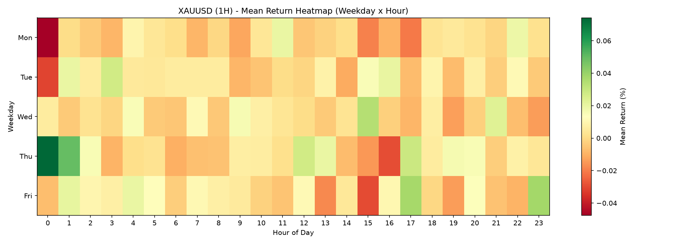
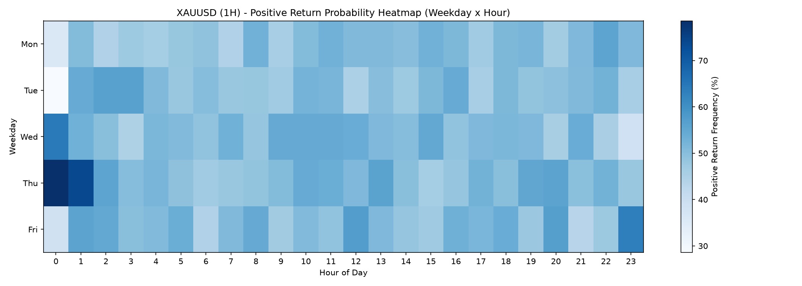
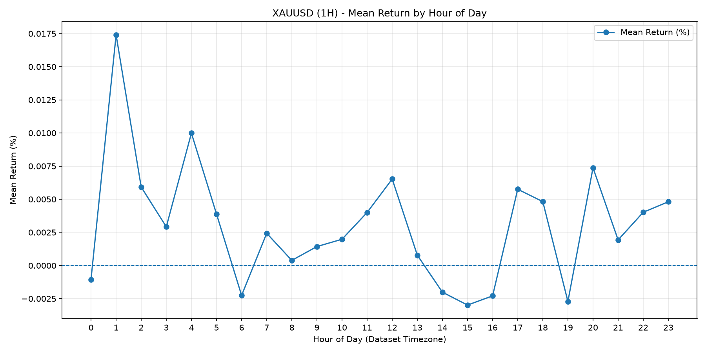
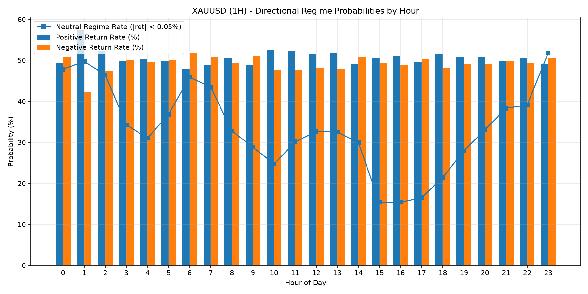
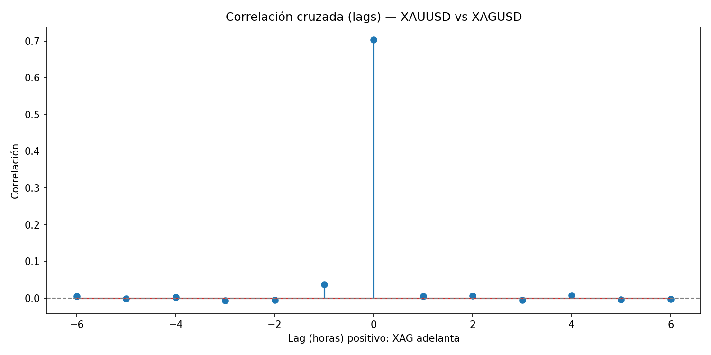
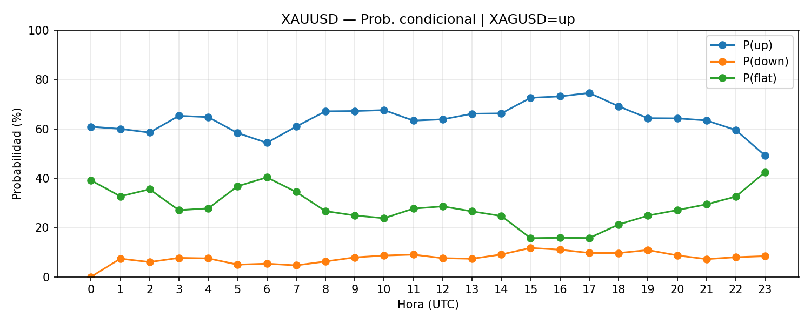
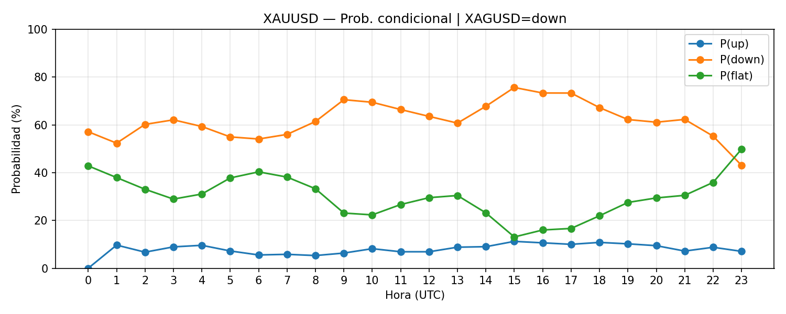
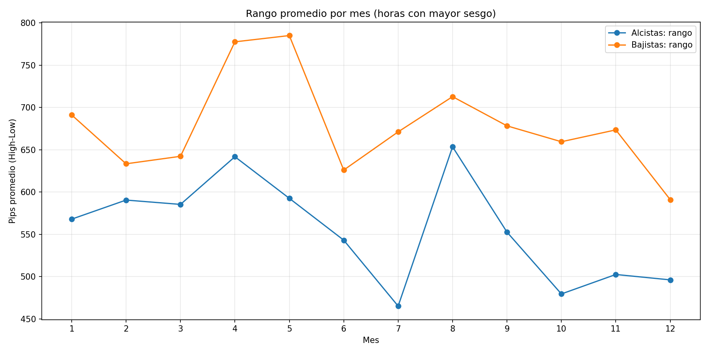

# Precious Metals Intraday Econometrics & Cross-Asset Conditional Regimes

Empirical time-series analysis of intraday seasonality, volatility clustering, and cross-asset conditional probabilities between Spot Gold (`XAUUSD`) and Spot Silver (`XAGUSD`) on hourly (`1H`) resolution.

---

## Overview

This project implements a quantitative research pipeline in Python to evaluate non-random calendar anomalies, intraday volatility structure (in pips and percentage returns), and lead-lag / contemporaneous regime coupling across precious metal markets.

The methodology is structured into three analytical modules:
1. **Intraday Seasonality & Directional Probability Heatmaps (`src/intraday_seasonality_stats.py`)**: Evaluates first and second moments of hourly return distributions across trading sessions and weekdays (`Monday` through `Friday`), isolating high-expectancy directional windows.
2. **Monthly & Session Volatility Structure (`src/monthly_volatility_pips.py`)**: Quantifies absolute pip displacement and high-low hourly range expansion across calendar months, ranking optimal `(Weekday, Hour)` pairs by directional expectancy.
3. **Cross-Asset Lagged Correlation & Conditional Regime Lift (`src/cross_asset_conditional_regimes.py`)**: Computes cross-correlation functions across lags $k \in [-6, +6]$ hours and evaluates discrete state transition probabilities $P(\text{State}_{\text{XAU}, t} \mid \text{State}_{\text{XAG}, t-k})$ across directional regimes (`up`, `down`, `flat`).

---

## Mathematical Formulation

### 1. Regime Discretization
For a neutral noise threshold $\tau = 0.05\%$, hourly percentage returns $r_t = \frac{P_t - P_{t-1}}{P_{t-1}} \times 100$ are mapped into three discrete states:

$$S_t = \begin{cases} \text{up}, & r_t > \tau \\ \text{down}, & r_t < -\tau \\ \text{flat}, & |r_t| \le \tau \end{cases}$$

### 2. Conditional Probability & Regime Lift
For each hour of the day $h \in \{0, \dots, 23\}$ and lag $k$, the conditional probability and predictive lift of Gold (`A`) given Silver (`B`) are defined as:

$$P(S_{A,t} = i \mid S_{B,t-k} = j, \, \text{Hour}(t) = h), \quad \text{Lift}_{i \mid j}(h) = \frac{P(S_{A,t} = i \mid S_{B,t-k} = j, \, h)}{P(S_{A,t} = i \mid h)}$$

---

## Key Empirical Results

### Cross-Asset Correlation Structure (`XAUUSD` vs. `XAGUSD`)
* Contemporaneous hourly returns ($k = 0$) exhibit strong positive coupling ($r = 0.7030$).
* Linear cross-correlation decays sharply for $k \neq 0$ ($r_{-1} = 0.0375$), demonstrating that linear lead-lag effects are rapidly arbitrage-corrected within a single hourly bar, whereas conditional state probabilities ($P(\text{up} \mid \text{up})$) exhibit significant regime persistence during London and New York session overlaps.

| Lag (Hours) | Pearson Correlation ($r$) | Interpretation |
| :---: | :---: | :--- |
| `-2` | `-0.0053` | Gold leads Silver by 2h (noise) |
| `-1` | `+0.0375` | Gold leads Silver by 1h (weak positive drift) |
| `0` | `+0.7030` | Contemporaneous hourly co-movement |
| `+1` | `+0.0056` | Silver leads Gold by 1h |
| `+2` | `+0.0062` | Silver leads Gold by 2h |

---

## Visual Analytics

### 1. Intraday Seasonality & Weekday-Hour Heatmaps
| Mean Return Heatmap (Weekday x Hour) | Positive Return Probability Heatmap |
| :---: | :---: |
|  |  |

| Hourly Mean Return Profile | Hourly Directional Regime Probabilities |
| :---: | :---: |
|  |  |

### 2. Cross-Asset Conditional Regimes (`XAUUSD` given `XAGUSD`)
| Cross-Correlation Function ($k \in [-6, +6]$) | Conditional Probability ($XAG = \text{up}$) |
| :---: | :---: |
|  |  |

| Conditional Probability ($XAG = \text{down}$) | Monthly Pip Volatility Profile |
| :---: | :---: |
|  |  |

---

## Repository Structure

```text
precious-metals-intraday-econometrics/
├── data/
│   ├── XAUUSD_H1.csv                        # Spot Gold hourly OHLCV time-series
│   └── XAGUSD_H1.csv                        # Spot Silver hourly OHLCV time-series
├── plots/                                   # Generated statistical figures and heatmaps
├── tables/                                  # Exported CSV empirical summary tables
│   ├── best_up_pairs.csv
│   ├── best_down_pairs.csv
│   ├── cond_hour_XAUUSD_given_XAGUSD.csv
│   ├── monthly_pips_overall.csv
│   └── xcorr_XAUUSD_vs_XAGUSD.csv
├── src/
│   ├── intraday_seasonality_stats.py        # Hourly return distributions and weekday heatmaps
│   ├── monthly_volatility_pips.py           # Pip range expansion and optimal session windows
│   └── cross_asset_conditional_regimes.py   # Lagged cross-correlation and conditional lift
├── .gitignore
├── requirements.txt
└── README.md
```

---

## Reproduction & Usage

```bash
# 1. Install dependencies
pip install -r requirements.txt

# 2. Run intraday seasonality and weekday-hour heatmap analysis
python src/intraday_seasonality_stats.py

# 3. Run monthly pip volatility and optimal window ranking
python src/monthly_volatility_pips.py

# 4. Run cross-asset correlation and conditional regime model (lag = 0 or lag = 1)
python src/cross_asset_conditional_regimes.py --cond-lag 0
python src/cross_asset_conditional_regimes.py --cond-lag 1
```

---

## Author

**Andrés Felipe Maestre Badillo**  
B.S. Candidate in Energy and Sustainability Engineering — Minor in Data Science  
Universidad Autónoma de Bucaramanga (UNAB)  
Email: afmae556@gmail.com
